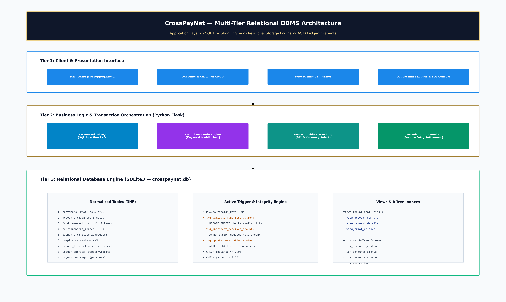
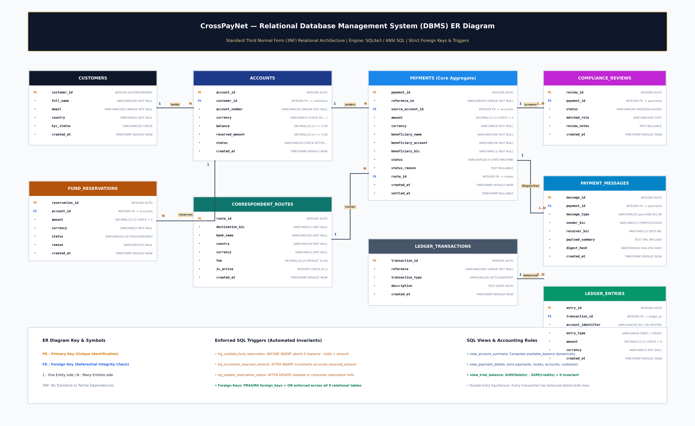
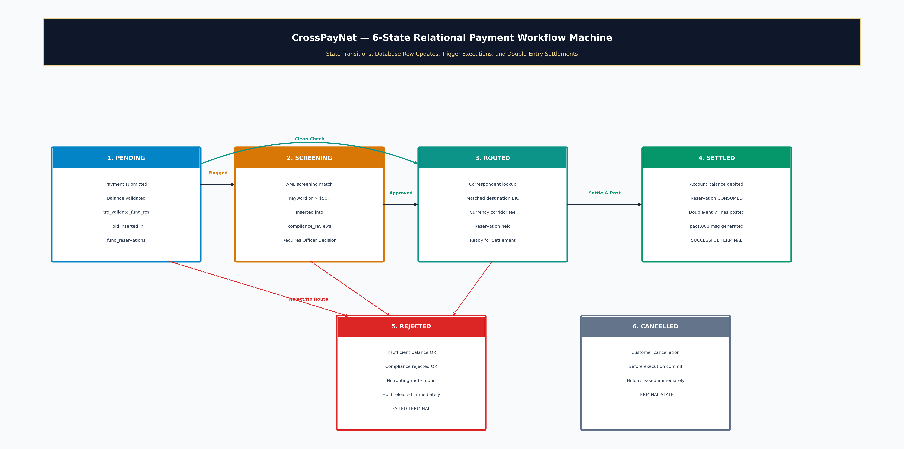
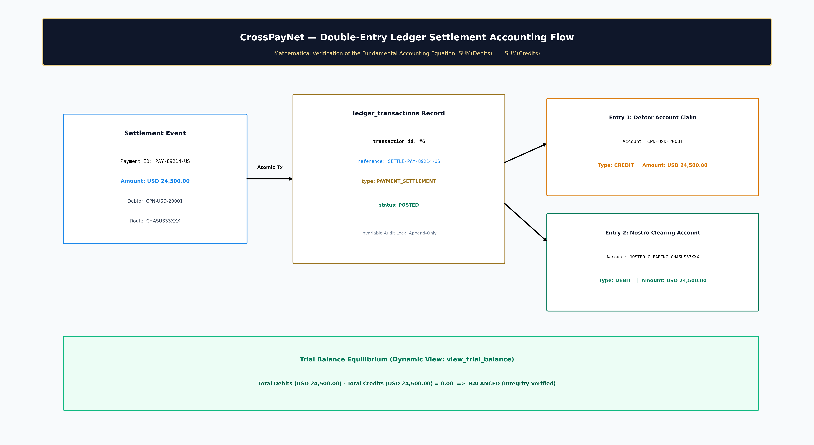

# CrossPayNet — Cross-Border Payment & Relational Settlement Simulator

CrossPayNet is an educational **Cross-Border Payment Messaging & Financial Settlement Simulator** built as a relational database management system (DBMS) demonstration project.

---

## 🚀 Quickstart: Running on Localhost

### 1. Prerequisites
- Python 3.10+ installed

### 2. Install Dependencies
```bash
pip install -r requirements.txt
```

### 3. Start the Server
```bash
python app.py
```

### 4. Access the Application
Open your web browser and navigate to:
👉 **[http://localhost:5000](http://localhost:5000)** (or **[http://127.0.0.1:5000](http://127.0.0.1:5000)**)

*On first startup, the application automatically initializes the SQLite schema (`database/schema.sql`) and populates realistic demonstration seed data (`database/seed.sql`).*

---

## 🏛️ System Architecture

CrossPayNet models real-world cross-border financial settlement (inspired by SWIFT, Fedwire, and SEPA) through an ACID-compliant relational architecture:



### Key Architectural Layers:
1. **Presentation Layer**: Responsive executive fintech interface (60-30-10 palette) with live operations dashboard, customer accounts, wire payment simulator, general ledger, and an interactive SQL console.
2. **Business & Security Layer (Python Flask)**:
   - Parameterized SQL execution preventing SQL Injection vulnerabilities.
   - Real-time sanctions and AML screening engine.
   - Dynamic correspondent BIC routing and currency matching.
   - Atomic ACID transaction coordination.
3. **Relational Database Engine (SQLite3)**:
   - Strict Third Normal Form (3NF) relational tables.
   - Automated event-driven procedural SQL triggers.
   - Relational views computing dynamic liquidity balances and double-entry trial balance equilibrium.

---

## 📐 Entity-Relationship (ER) Diagram



### Relational Tables & Schema Specifications:
- **`customers`**: Customer profile directory (full name, email, ISO-3 country, verified KYC status).
- **`accounts`**: Multi-currency bank accounts (`USD`, `EUR`, `GBP`, `INR`, `SGD`, `JPY`) with balance and trigger-managed reservation hold tracking.
- **`fund_reservations`**: Cryptographically verifiable liquidity reservation tokens (`ACTIVE`, `CONSUMED`, `RELEASED`).
- **`correspondent_routes`**: Directory of international clearing banks, SWIFT/BIC codes, and currency settlement fees.
- **`payments`**: The central transaction aggregate tracking the 6-state payment lifecycle.
- **`compliance_reviews`**: Audit trail of transactions flagged for sanctions matching or high-value limits.
- **`ledger_transactions`**: Journal transaction headers with immutable references.
- **`ledger_entries`**: Double-entry financial journal lines (`DEBIT` and `CREDIT`).
- **`payment_messages`**: Financial wire messages simulating ISO 20022 `pacs.008` with SHA-256 integrity digest hashes.

---

## 🔄 Payment Lifecycle State Machine



Every payment instruction executes through an automated 6-state relational workflow:
1. **`PENDING`**: Validates debtor available balance against trigger `trg_validate_fund_reservation` and inserts a fund hold.
2. **`SCREENING`**: Evaluates sanctions keywords and high-value limits ($\ge \$50,000$). Flagged payments are held for compliance officer approval.
3. **`ROUTED`**: Matches the destination bank BIC with an active currency clearing corridor.
4. **`SETTLED`** *(Terminal Success)*: Atomically debits customer balance, consumes the hold, posts balancing double-entry ledger lines, and logs the SHA-256 hashed `pacs.008` wire message.
5. **`REJECTED`** / **`CANCELLED`** *(Terminal Failure)*: Hold token is instantly released back to available balance via trigger `trg_update_reservation_status`.

---

## ⚖️ Double-Entry Financial Accounting Flow



CrossPayNet enforces mathematical ledger equilibrium:
$$\sum \text{Debits} - \sum \text{Credits} = 0.00$$

For every settled cross-border wire instruction:
- **Credit Entry**: Reduces the ordering customer's deposit liability claim.
- **Debit Entry**: Increases the correspondent partner bank's Nostro clearing account claim.
- Verified in real time via the dynamic SQL view `view_trial_balance`.

---

## 🧪 Testing & Verification

Run the automated test suite covering all 7 unit and integration tests:
```bash
python test_app.py
```
